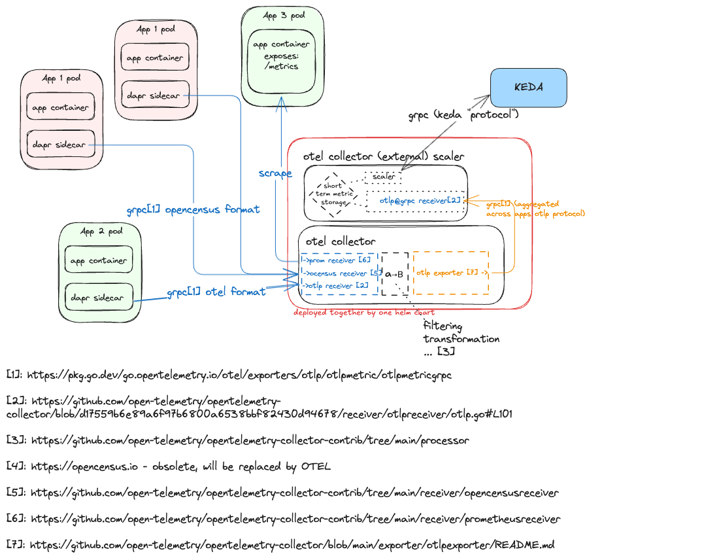

## `OTel <--> KEDA` add-on

[](https://artifacthub.io/packages/search?repo=otel-add-on)

### Description

This is an external scaler for KEDA that integrates with OpenTelemetry (OTel) collector. The helm chart deploys also OTel
collector (using the [upstream helm chart](https://github.com/open-telemetry/opentelemetry-helm-charts)) where one can set up
filtering so that scaler receives only those metrics that are needed for scaling decisions 
([example](https://github.com/kedify/otel-add-on/blob/v0.0.0-1/helmchart/otel-add-on/values.yaml#L133-L147)).

The application consists of three parts:
- OTLP receiver
- simple metric storage
- external scaler for KEDA

#### Receiver

This component is implementation of OTLP Receiver [spec](https://github.com/open-telemetry/opentelemetry-collector-contrib/tree/main/receiver/opencensusreceiver),
so that it spawns a GRPC server ([by default](https://github.com/kedify/otel-add-on/blob/v0.0.0-1/helmchart/otel-add-on/values.yaml#L60) on port `4317`)
and stores all incoming metrics in the short term storage - simple metric storage.

#### Simple Metric Storage

Very simple metric storage designed to remember last couple of measurements (~ 10-100) for each metric vector. It can be 
[configured](https://github.com/kedify/otel-add-on/blob/v0.0.0-1/helmchart/otel-add-on/values.yaml#L11-L12)
with number of seconds to remember. Then during the write operation, it removes the stale measurements, so it effectively works as a
cyclic buffer. Metrics are stored together with labels (key-value pairs) for later querying.

#### External Scaler

This component also spawns GRPC server ([by default](https://github.com/kedify/otel-add-on/blob/v0.0.0-1/helmchart/otel-add-on/values.yaml#L61) on port `4318`)
and can talk to KEDA operator by implementing the External Scaler [contract](https://keda.sh/docs/2.15/concepts/external-scalers/).

It queries the internal in-memory metric storage for metric value and sends it to KEDA operator. The metric query is specified as a metadata on KEDA's
ScaledObject CR, and it provides a limited subset of features as PromQL.

#### Metric expressions

Both ScaledObject `metricQuery` metadata and REST `/memstore/query` requests
support arithmetic and nested functions. Expressions accept decimal and scientific
numeric literals, multiline whitespace, parentheses, unary `+`/`-`, and binary
`+`, `-`, `*`, `/`, `%`, and `^`. The vector union operator `or` has lower precedence
than arithmetic and supports explicit fallbacks. Arithmetic precedence follows
PromQL: exponentiation binds most tightly and associates right to left, followed by
unary signs, multiplication, division and modulo, then addition and subtraction.
For example, `-2 ^ 2` is `-4`.

| Function | Arguments | Result |
| --- | --- | --- |
| `ln` | vector | Natural logarithm of each value |
| `log2` | vector | Base-2 logarithm of each value |
| `scalar` | vector | Scalar value of exactly one series; otherwise NaN |
| `vector` | scalar | One unlabeled series containing the scalar |
| `clamp_min` | vector, scalar | Raise each value to at least the scalar |
| `clamp_max` | vector, scalar | Lower each value to at most the scalar |
| `sum`, `avg`, `min`, `max`, `count` | vector | One unlabeled series containing the aggregate |

Evaluation first applies `operationOverTime` to each stored series, then evaluates
the expression on those values. Scalar arithmetic applies to every vector element.
Arithmetic between vectors, including differently named metrics, matches their
complete label sets, ignoring `__name__`. Label values are compared as strings and
label order does not matter. Unmatched series are omitted; duplicate matching label
sets produce an error. Labels are retained until an explicit aggregation removes
them, so `count(sum(metric))` returns `1` when the selector is nonempty.

An aggregation such as `sum(metric)` returns a vector even when it contains one
series. Use `scalar(log2(sum(requests))) - errors` to subtract each labeled
`errors` value from the same number without vector label matching. There is no
implicit vector-to-scalar conversion. Like PromQL's [`scalar()`](https://prometheus.io/docs/prometheus/latest/querying/functions/#scalar),
`scalar` requires one vector argument and returns NaN if it contains zero or
multiple series; a nonfinite final result is rejected as described below.

Missing selectors produce empty vectors, as in PromQL. Use
`sum(optional_metric) or vector(0)` to explicitly substitute zero for an absent
aggregate. `or` keeps every left-hand series plus right-hand series whose labels
have no match on the left; an existing left-hand value wins, including zero or
NaN. Aggregate first when you want one total with an unlabeled fallback:

```promql
log2(sum(requests)) - (sum(optional_updates) or vector(0))
```

This subtracts zero until updates are populated, then subtracts their total.
Apply the fallback before `scalar()` when needed, for example
`scalar(sum(optional_metric) or vector(0))`. A fallback after the entire arithmetic
expression would replace that entire result rather than just the missing operand.

A scalar result is returned directly. A final vector is summed implicitly. Empty
vectors, including empty aggregations, use the existing metric-not-found behavior;
fallback values are never inserted into intermediate expressions. Intermediate
floating-point values may be infinite or NaN (for example, `ln(0)` and `ln(-1)`).
A nonfinite final expression result is rejected before the optional ScaledObject
`clampMin` and `clampMax` metadata limits are applied.

Use the normalized metric names shown by `/memstore/names`: stored metric names
replace `.`, `/`, and `-` with `_`. Dotted names remain accepted as aliases, but `/`
and `-` in queries always mean arithmetic. Label names and values remain unchanged.
Every referenced metric is registered for lazy collection, and repeated selectors
share a single metric snapshot within each evaluation. Existing lazy warmup rules
and stale-series filtering still apply.

Other functions, the `and`/`unless` operators, comparisons, grouping/vector-matching
modifiers, range selectors, offsets, and subqueries are unsupported. Admission
requires a nonblank query and valid required metadata/time operations; the
application compiler checks expression syntax, argument counts, and scalar/vector
types.

#### Metric label matching

Metric queries support the PromQL label operators `=` (equal), `!=` (not equal),
`=~` (regex match), and `!~` (negative regex match). For example:

```promql
queue_depth{queue=~"orders-.*",environment!="dev"}
```

This query sums the selected values for queues beginning with `orders-`, excluding
those with `environment="dev"`. You can wrap the selector in `sum`, `avg`, `min`,
`max`, or `count` to choose how matching series are aggregated; `operationOverTime`
still determines the value read from each series.

All matchers must pass, including repeated conditions on the same label, such as
`queue_depth{queue=~"orders-.*",queue!="orders-test"}`. Regexes use RE2 syntax,
match the entire label value, and allow `.` to match newlines. Use `.*` explicitly
when you want a substring match.

Missing labels are treated as empty strings: `environment!="dev"` includes series
without that label, `environment=""` selects missing or empty values, and
`environment!=""` requires a nonempty value. Selectors aggregate all matching,
non-stale series, including series with additional labels. No matching series
uses the configured metric-not-found behavior.

Double quotes, single quotes, and backticks are supported for label values.
Single and double quotes use Go-style escapes; backticks preserve their contents.
Existing shorthand such as `queue_depth{queue=orders}` remains supported.

### Architecture

- ([diagram link](https://excalidraw.com/#json=P5ptHj7eQHF3qpCyDDehT,gVJvYLtm0qVR2sStjUlapA))
- [1] [OTLP format](https://pkg.go.dev/go.opentelemetry.io/otel/exporters/otlp/otlpmetric/otlpmetricgrpc)
- [2] [OTLP metric receiver](https://github.com/open-telemetry/opentelemetry-collector/blob/d17559b6e89a6f97b6800a6538bbf82430d94678/receiver/otlpreceiver/otlp.go#L101)
- [3] [processors](https://github.com/open-telemetry/opentelemetry-collector-contrib/tree/main/processor)
- [4] https://opencensus.io - obsolete, will be replaced by OTel
- [5] [OpenCensus receiver](https://github.com/open-telemetry/opentelemetry-collector-contrib/tree/main/receiver/opencensusreceiver)
- [6] [Prometheus receiver](https://github.com/open-telemetry/opentelemetry-collector-contrib/tree/main/receiver/prometheusreceiver)
- [7] [OTLP exporter](https://github.com/open-telemetry/opentelemetry-collector/blob/main/exporter/otlpexporter/README.md)

### Example use-cases

#### 1. convert and react on metrics from OpenCensus

By specifying an [opencensus receiver](https://github.com/kedify/otel-add-on/blob/v0.0.0-1/helmchart/otel-add-on/values.yaml#L112) in the helm chart values for OTel collector,
we will get the ability to get those metrics into our scaler.

#### 2. convert and react on metrics from any other upstream receiver
OTel collector contains [numerous](https://github.com/open-telemetry/opentelemetry-collector-contrib/tree/main/receiver) integrations on the receiver part.
All of these various receivers open new ways of how to turn metric from OTel receiver into KEDA scaler. For instance by using 
[sqlqueryreceiver](https://github.com/open-telemetry/opentelemetry-collector-contrib/tree/main/receiver/sqlqueryreceiver), one can achieve similar goals as with
[MySQL](https://keda.sh/docs/2.15/scalers/mysql/) or [PostgreSQL](https://keda.sh/docs/2.15/scalers/postgresql/) scalers. 
By using [githubreceiver](https://github.com/open-telemetry/opentelemetry-collector-contrib/tree/main/receiver/githubreceiver), one can hook to
metrics from GitHub, etc.

#### 3. process the metrics before reaching the scaler
OTel collector provides [various processors](https://github.com/open-telemetry/opentelemetry-collector-contrib/tree/main/processor)
that are being applied on all incoming metrics/spans/traces and one achieve for instance metric [filtering](https://github.com/kedify/otel-add-on/blob/v0.0.0-1/helmchart/otel-add-on/values.yaml#L138-L143)
this way. So that not all the metric data are passed to scaler's short term memory. This way we can keep the OTel scaler pretty lightweight.

OTTL lang:
- [spec](https://github.com/open-telemetry/opentelemetry-collector-contrib/blob/main/pkg/ottl/LANGUAGE.md)
- [functions](https://github.com/open-telemetry/opentelemetry-collector-contrib/tree/main/pkg/ottl/ottlfuncs)

The scaler can combine metrics with matching labels and evaluate arithmetic in
`metricQuery`. To derive metrics within the collector pipeline, the
[Metrics Generation Processor](https://github.com/open-telemetry/opentelemetry-collector-contrib/tree/main/processor/metricsgenerationprocessor)
is also available.

#### 4. OTel patterns (metric pipelines)
Basically any scenario described in [OTel patterns](https://github.com/jpkrohling/opentelemetry-collector-deployment-patterns) or [architecture](https://opentelemetry.io/docs/collector/architecture/)
should be supported. So no matter how the OTel collectors are deployed, whether it's a fleet of sidecar containers deployed alongside each workload or
some complex pipeline that spans multiple Kubernetes clusters, you will be covered.

## Installation

### First install KEDA
```bash
helm repo add kedacore https://kedacore.github.io/charts
helm repo update
helm upgrade -i keda kedacore/keda --namespace keda --create-namespace
```

### Then install this add-on
```bash
helm upgrade -i keda-otel-scaler -nkeda oci://ghcr.io/kedify/charts/otel-add-on --version=v0.1.5
```

### Create an example scaled object
```bash
k apply -f examples/so.yaml
```

### Advanced setups

Check some prepared examples in the [`./examples`](./examples) directory and also check the `dev.Makefile` if you want to
set up mTLS between a collector and this scaler. 

For an AWS integration, see the runnable
[CloudWatch Metric Streams example](./examples/cloudwatch-metric-stream/README.md), which scales an EKS workload from an
NLB metric delivered as OpenTelemetry 1.0 through Amazon Data Firehose.

```bash
λ make -f dev.Makefile
Usage:
  make <target>
Demos
  demo-istio-grpc           setup ./examples/istio-grpc
  demo-podinfo              setup ./examples/metric-pull
  demo-podinfo-dev          setup ./examples/metric-pull
  demo-podinfo-tls          setup ./examples/metric-pull with TLS
  demo-otel-upstream        setup ./examples/metric-push
  demo-operator             setup ./examples/otel-operator
  demo-operator-tls         setup ./examples/otel-operator with TLS  
...
λ make -f dev.Makefile demo-podinfo-tls
```

## Troubleshooting

To figure out the actual value of a metric query, there is a simple REST API that can be used:

```bash
(kubectl port-forward svc/keda-otel-scaler 9090&)
# swagger doc: http://localhost:9090/swagger/index.html
# test the existing metric query
curl -X 'POST' \
  'http://localhost:9090/memstore/query' \
  -H 'accept: application/json' \
  -H 'Content-Type: application/json' \
  -d '{
  "operationOverTime": "last_one",
  "query": "kube_deployment_status_replicas_available{deployment=foo,namespace=observability}"
}'
{
    "ok": true,
    "operation": "query",
    "error": "",
    "value": 1
}

# check the data if the labels are stored there correctly:
curl -X 'GET' \
  'http://localhost:9090/memstore/data' \
  -H 'accept: application/json' | jq '.kube_deployment_status_replicas_available[].labels'
{
  "deployment": "keda-operator",
  "namespace": "keda"
}
```

### Configuration for OTel collector

This repo has the OTel collector helm chart as a dependency and some issues in the configuration are guarded
by their upstream JSON Schema, but some are not, and it's a good idea to run the validator (especially if it's part
of a CI/CD pipeline):

```
# 1) download the binary
VERSION=0.117.0
curl -sL https://github.com/open-telemetry/opentelemetry-collector-releases/releases/download/v${VERSION}/otelcol-contrib_${VERSION}_$(go env GOOS)_$(go env GOARCH).tar.gz | tar xvz - -C .

# 2) run the validator against your helm chart values
./otel-contrib validate --config=<(cat values.yaml | yq '.opentelemetry-collector.alternateConfig')
```

Alternatively, you may want to use online tools such as [otelbin.io](https://www.otelbin.io/).
