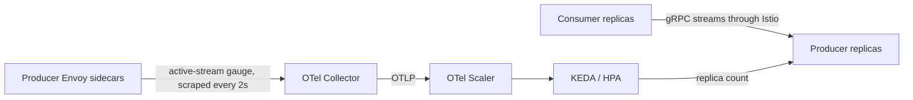

# Autoscaling gRPC streams with Istio and the OTel Scaler

This demo scales a Python gRPC producer from the number of open server-streaming
calls. Each consumer logs PI messages and, when the stream ends, closes its gRPC
channel and opens a new connection through the `producer` Service. The consumer
keeps running, and each new stream can reach a different producer replica.



The producer's capacity is a **soft target**, defaulting to three concurrent
streams. A fourth stream is accepted and triggers a second producer. Existing
streams stay on their original producer; subsequent streams can reach new replicas.
Capacity overruns and producer identities are logged. This demonstrates scaling
from concurrency; the capacity setting does not enforce a throughput limit.

## Run

Prerequisites: Docker running with enough resources for Istio, KEDA, the collector,
and the workload (allow roughly 4 CPUs and 6 GiB of memory), plus `k3d`, `helm`, `kubectl`,
`curl`, and Python 3.11 or newer on the host. The host does not need gRPC packages.

From the repository root:

```bash
./examples/istio-grpc/setup.sh
# or:
make -f dev.Makefile demo-istio-grpc
```

Setup uses the installed `k3d`, K3s **1.37.1**, and Istio **1.31.1**, and exits
immediately if `k3d` is missing. The default cluster command is:

```bash
k3d cluster create istio-grpc --image=rancher/k3s:v1.37.1-k3s1
```

K3s release versions contain `+k3s1`; Docker image tags use `-k3s1`.
Override versions with `K3S_IMAGE`, `ISTIO_VERSION`, or `KEDA_VERSION`.
For example, to use Kubernetes 1.36:

```bash
K3S_IMAGE=rancher/k3s:v1.36.0-k3s1 ./examples/istio-grpc/setup.sh
```

Setup creates or reuses only `istio-grpc`, rejects an existing cluster with a
different Kubernetes version, and leaves the current kubeconfig context unchanged.
All commands below select the demo context explicitly. Rerunning setup resets
consumer replicas to one and rolls workloads to pick up their updated ConfigMaps.

On macOS, launch the guided demo in iTerm2 instead:

```bash
./examples/istio-grpc/demo-mac.sh
```

It opens a new maximized window with deployment output on the left, scaler logs
in the middle, and a wider right column containing all pods, live stream counts,
and a prepared command to scale consumers to five. Setup runs automatically;
afterward, press any key in the left pane to follow producer logs, or Return in
the bottom-right pane to run the scaling command. The right column takes half
the window width; its pod listing takes half the height. A larger window or
smaller iTerm2 font helps when starting from a 113-column, 22-line terminal.

The metric pane discovers `app=producer` pods every two seconds and queries each
Envoy metrics endpoint through the Kubernetes API pod proxy, displaying individual
counts and their total. It follows replicas as they appear and disappear without
local port-forwards. Log panes reconnect when the set of pods changes. Commands
always select `k3d-istio-grpc`, so the pod watcher provides the equivalent of
`wa kpp` without depending on shell aliases. Setup overrides shown below also
work with `demo-mac.sh`. Stop watchers with Ctrl-C or close the demo window;
temporary coordination files are removed when all five pane commands have exited.

Istio runs in sidecar mode. Native sidecars start Envoy before the bootstrap init
container installs the pinned Python wheels and generates protobuf bindings. Both
workloads use the stock `python:3.13-slim-bookworm` image and ConfigMap-mounted
sources; no image build is required. First startup of each new pod needs access to
PyPI. KEDA and the collector run outside the injected namespace.

## Trigger scaling

Initially there is one producer and one consumer. In one terminal, watch:

```bash
kubectl --context=k3d-istio-grpc -n istio-grpc get deployments --watch
```

In another terminal, scale consumers:

```bash
# Three simultaneous streams fit within one producer's target capacity.
kubectl --context=k3d-istio-grpc -n istio-grpc scale deployment/consumer --replicas=3

# Four simultaneous streams should request two producers.
kubectl --context=k3d-istio-grpc -n istio-grpc scale deployment/consumer --replicas=4

# Ten simultaneous streams should request four producers.
kubectl --context=k3d-istio-grpc -n istio-grpc scale deployment/consumer --replicas=10
```

Allow time for pod startup, the consumer delay, scraping, and HPA reconciliation.
The desired producer count is approximately `ceil(active streams / capacity)`,
bounded between one and ten and subject to HPA tolerance and stabilization. Counts
can temporarily dip while consumers reconnect. Normal stream completion immediately
opens a fresh connection through the Service, without restarting the container or
repeating the startup delay.

Inspect messages and producer identities:

```bash
kubectl --context=k3d-istio-grpc -n istio-grpc logs -l app=consumer -c consumer --prefix --tail=10
kubectl --context=k3d-istio-grpc -n istio-grpc logs -l app=producer -c producer --prefix --tail=10
```

Stop the load and observe producers eventually return to one:

```bash
kubectl --context=k3d-istio-grpc -n istio-grpc scale deployment/consumer --replicas=0
```

Scale-down stabilization is 60 seconds. Finite streams reconnect over time, which
lets new producers start serving calls; adding replicas cannot move open streams.
Each consumer sidecar makes its own least-request balancing decisions, so this is
not a guarantee of globally even stream distribution.

## Configuration

Set workload environment variables when invoking setup. They are stored in
`workload-config` and applied to both Deployments.

| Variable | Default | Meaning |
| --- | --- | --- |
| `MESSAGE_INTERVAL_SECONDS` | `5±1` | Seconds between messages; sampled for each gap |
| `MESSAGE_COUNT` | `30±5` | Number of messages; sampled once per stream |
| `CONSUMER_START_DELAY_SECONDS` | `5±2` | Delay before connecting on each container start |
| `PRODUCER_CAPACITY` | `3` | Producer soft capacity and ScaledObject target |
| `PI_INITIAL_DIGITS` | `100` | Decimal places in the first message |
| `PI_DIGITS_STEP` | `100` | Decimal places added per subsequent message |
| `PRODUCER_ADDRESS` | `producer:50051` | Consumer's gRPC destination; use the Service name to allow balancing across replicas |

Timing and count values accept integers or `base±spread`. The latter uniformly
samples an integer from the inclusive interval: `5±1` produces 4, 5, or 6.
Negative intervals and malformed values are rejected. Message counts, capacity,
and precision settings must be positive. Timing values may be zero; very short
streams may finish between metric scrapes and will not reliably demonstrate scaling.

```bash
PRODUCER_CAPACITY=5 \
MESSAGE_INTERVAL_SECONDS='6±2' \
MESSAGE_COUNT='40±5' \
CONSUMER_START_DELAY_SECONDS=2 \
PI_INITIAL_DIGITS=100 PI_DIGITS_STEP=50 \
./examples/istio-grpc/setup.sh
```

Setup renders `scaledobject.yaml` with the same capacity value used by the producer.
To change capacity later, rerun setup with `PRODUCER_CAPACITY`; changing only the
Deployment environment does not update the ScaledObject.

The protobuf interface is `istio_grpc.Producer/Stream`, taking `StreamRequest {}`
and returning a stream of `Message { string text = 1; }`. Every stream starts at
ordinal zero. Its first message is immediate; there is no delay after the last one:

```text
msg: 0: 3.1415926535
msg: 1: 3.14159265358979323846
```

The example above uses initial precision 10 and step 10. PI is recomputed for each
message with [Chudnovsky integer binary splitting](https://github.com/kedify/kedr/blob/main/examples/cpu-throttle/manifest.yaml),
using an integer square root and guard digits. Increasing precision costs CPU and
produces larger log lines; the default workload stays small.

## Metric pipeline and inspection

Istio's `proxyStatsMatcher` enables the Envoy active-request gauge. The collector
discovers producer pods, selects the `istio-proxy` metrics port exactly once per
pod, and retains only:

```text
envoy_cluster_upstream_rq_active{cluster_name="inbound|50051||"}
```

The inbound cluster represents Envoy forwarding calls to the local producer. Each
open gRPC call is one active HTTP/2 request. The collector ignores outbound metrics,
other ports, and other workloads to avoid double counting. TCP connection counts
could undercount because HTTP/2 multiplexes streams. See
[Envoy statistics](https://www.envoyproxy.io/docs/envoy/latest/configuration/upstream/cluster_manager/cluster_stats.html)
and [Istio Envoy statistics](https://istio.io/latest/docs/ops/configuration/telemetry/envoy-stats/).

The query uses the latest gauge value from each producer and sums them:

```text
sum(envoy_cluster_upstream_rq_active{namespace="istio-grpc",cluster_name="inbound|50051||"})
```

The ScaledObject uses `operationOverTime: last_one` and `metricType: AverageValue`.
This measures current concurrency. Changing message frequency while keeping the
same streams open should leave the metric unchanged. Samples expire after 15 seconds
when a producer disappears; running producers also report zero after calls close.

To inspect the scaler:

```bash
kubectl --context=k3d-istio-grpc -n keda port-forward service/keda-otel-scaler 9090:9090
```

Then, in another terminal:

```bash
curl -sS http://localhost:9090/memstore/query \
  -H 'Content-Type: application/json' \
  -d '{"operationOverTime":"last_one","query":"sum(envoy_cluster_upstream_rq_active{namespace=istio-grpc,cluster_name=inbound|50051||})"}'

curl -sS http://localhost:9090/memstore/data
```

To inspect raw Envoy metrics, forward a producer pod's metrics port:

```bash
kubectl --context=k3d-istio-grpc -n istio-grpc port-forward deployment/producer 15090:15090
curl -sS http://localhost:15090/stats/prometheus | rg '^envoy_cluster_upstream_rq_active'
```

If scaling stalls, inspect pod readiness, the collector, and the ScaledObject:

```bash
kubectl --context=k3d-istio-grpc -n istio-grpc get pods
kubectl --context=k3d-istio-grpc -n istio-grpc logs deployment/producer -c bootstrap
kubectl --context=k3d-istio-grpc -n keda logs deployment/otelcol --tail=50
kubectl --context=k3d-istio-grpc -n istio-grpc describe scaledobject producer
kubectl --context=k3d-istio-grpc -n istio-grpc describe hpa keda-hpa-producer
```

## Local tests

Install the same dependencies into an isolated environment and generate bindings
outside the source directory:

```bash
cd examples/istio-grpc
python3 -m venv .venv
.venv/bin/pip install -r app/requirements.txt
mkdir -p generated
.venv/bin/python -m grpc_tools.protoc -Iapp --python_out=generated --grpc_python_out=generated app/stream.proto
PYTHONPATH=app:generated .venv/bin/python -m unittest discover -s tests -v
```

Tests cover inclusive range sampling, invalid configuration, PI accuracy and long
output, growing precision, four concurrent streams, EOF, cancellation, and a real
consumer subprocess reconnecting after logging all messages.

## Cleanup

```bash
k3d cluster delete istio-grpc
```
