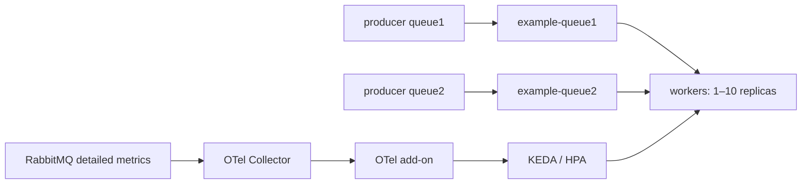

# Autoscale RabbitMQ task workers

This example runs RabbitMQ, two producer Deployments, and a worker Deployment
that consumes both `example-queue1` and `example-queue2`. RabbitMQ's Prometheus
plugin exposes queue depth, the OTel Collector forwards it to the add-on, and
KEDA scales `rabbitmq-worker` between 1 and 10 replicas using the arithmetic
expression in [rabbitmq-so.yaml](./rabbitmq-so.yaml).



## Run

Requirements: Docker, k3d, Helm, kubectl, Python 3.8+, and access to container
registries, Helm repositories, and PyPI during image builds.

From this directory:

```bash
./setup.sh
```

Setup creates or reuses the dedicated `rabbitmq` k3d cluster without deleting
existing clusters or changing the current kubeconfig context. It builds the
current checkout as `ghcr.io/kedify/otel-add-on:promql`, builds the Python
workloads as `rabbitmq-demo:latest`, and imports both images into that cluster.
It installs KEDA `v2.21.0-3`, the local add-on chart, the broker, and the workloads.
The `promql` image is required for the example's arithmetic query.

To reuse images you already built, run `BUILD_IMAGES=false ./setup.sh`.
`KEDA_VERSION` can override the default KEDA chart version. Rerunning setup
refreshes the workload configuration and restarts the worker, producers, and
scaler so they pick up new settings and same-tag images.

## Workloads and configuration

Each producer starts with one replica and publishes its first batch immediately,
then repeats every configured interval. Every replica runs its own publishing
loop, so scaling a producer increases traffic proportionally.

| Setup variable | Default | Meaning |
| --- | --- | --- |
| `WORK_SECONDS` | `2` | Time a worker spends on each task; zero is allowed |
| `QUEUE1_INTERVAL_SECONDS` | `5` | Seconds between queue1 producer batches, per replica |
| `QUEUE1_TASKS_PER_BATCH` | `5` | Tasks in each queue1 batch, per replica |
| `QUEUE2_INTERVAL_SECONDS` | `5` | Seconds between queue2 producer batches, per replica |
| `QUEUE2_TASKS_PER_BATCH` | `5` | Tasks in each queue2 batch, per replica |

Intervals and work times accept fractional seconds; batch sizes are positive
integers. For example:

```bash
WORK_SECONDS=3 QUEUE1_TASKS_PER_BATCH=10 QUEUE2_INTERVAL_SECONDS=8 ./setup.sh
```

The producer runtime variables are `QUEUE_NAME`, `INTERVAL_SECONDS`, and
`TASKS_PER_BATCH`. Setup maps the per-queue settings into each Deployment through
the `workload-config` ConfigMap. You can also change a running Deployment directly:

```bash
kubectl --context k3d-rabbitmq -n rabbitmq set env deployment/rabbitmq-worker WORK_SECONDS=4
kubectl --context k3d-rabbitmq -n rabbitmq set env deployment/rabbitmq-producer-queue1 INTERVAL_SECONDS=3 TASKS_PER_BATCH=8
```

Each worker handles one task at a time across both queues, with at most one
prefetched task per queue. Its logs include the actual configured sleep duration:

```text
received task #42 from example-queue1, I am working on it (sleep 2 seconds).. (producer=rabbitmq-producer-queue1-.../abc12345)
task #42 done (queue=example-queue1, producer=rabbitmq-producer-queue1-.../abc12345)
```

Task numbers are local to each producer process. The producer identity and AMQP
message ID distinguish tasks across replicas and restarts. Queues are durable,
messages are persistent, and publishers wait for broker confirmations. Workers
acknowledge only after processing; interrupting a worker requeues its unfinished
task, which can therefore appear in another worker's logs.

This is an ephemeral demo: the broker uses `emptyDir`, so replacing its Pod or
deleting the cluster removes broker data. Its demo credentials are `demo` / `demo`.

## Create more load

Scale each producer independently:

```bash
kubectl --context k3d-rabbitmq -n rabbitmq scale deployment/rabbitmq-producer-queue1 --replicas=3
kubectl --context k3d-rabbitmq -n rabbitmq scale deployment/rabbitmq-producer-queue2 --replicas=2
kubectl --context k3d-rabbitmq -n rabbitmq get deployments --watch
kubectl --context k3d-rabbitmq -n rabbitmq get hpa,scaledobjects
```

For a given queue, the average input rate is
`producer replicas × tasks per batch / interval seconds`. With defaults, one
producer replica creates one task per second. Consumers spend two seconds on
each task, so additional load builds a backlog and increases worker replicas.
The scaling expression is a nonlinear backlog signal, capped at 10 workers.

Follow workers and either producer:

```bash
kubectl --context k3d-rabbitmq -n rabbitmq logs -l app=rabbitmq-worker --prefix --tail=20 -f --max-log-requests=10
kubectl --context k3d-rabbitmq -n rabbitmq logs -l app=rabbitmq-producer-queue1 --prefix --tail=20 -f
kubectl --context k3d-rabbitmq -n rabbitmq logs -l app=rabbitmq-producer-queue2 --prefix --tail=20 -f
```

Stop new tasks and let workers drain the queues:

```bash
kubectl --context k3d-rabbitmq -n rabbitmq scale deployment/rabbitmq-producer-queue1 deployment/rabbitmq-producer-queue2 --replicas=0
```

## Inspect queue metrics and the scaling query

The Collector scrapes `/metrics/detailed?family=queue_coarse_metrics&vhost=%2F`
every two seconds. RabbitMQ's [detailed Prometheus endpoint](https://www.rabbitmq.com/docs/prometheus#detailed-endpoint)
exposes `rabbitmq_detailed_queue_messages_ready` with a `queue` label. The
Collector retains only that metric for the two example queues and exports it
over OTLP/gRPC to `keda-otel-scaler.keda.svc:4317`.

`operationOverTime` is `last_one`, because this metric is the current number of
ready messages rather than a cumulative counter. Acknowledgement happens after
work finishes, but in-flight tasks are not part of the ready-message metric.

The expression is evaluated per queue; the outer `max` picks the larger signal.
For queue depths 1 and 9 the results are 1.1 and 4.9, so the query returns 4.9.
Empty queues still have zero-valued series once they have been declared. Both
clients declare both queues on startup, including before their first task.

To query the add-on, keep this port-forward running:

```bash
kubectl --context k3d-rabbitmq -n keda port-forward service/keda-otel-scaler 19090:9090
```

In another terminal, submit the exact query from the ScaledObject:

```bash
curl --fail --silent --show-error http://localhost:19090/memstore/query \
  -H 'Content-Type: application/json' \
  -d '{
    "operationOverTime": "last_one",
    "query": "max(log2(clamp_min(rabbitmq_detailed_queue_messages_ready{queue=~\"example-queue1|example-queue2\"} - 1, 1)) + clamp_max(rabbitmq_detailed_queue_messages_ready{queue=~\"example-queue1|example-queue2\"}, 1) + rabbitmq_detailed_queue_messages_ready{queue=~\"example-queue1|example-queue2\"}/10)"
  }'
```

For the RabbitMQ management UI and raw metrics:

```bash
kubectl --context k3d-rabbitmq -n rabbitmq port-forward service/rabbitmq 15672:15672 15692:15692
# Open http://localhost:15672 and log in with demo / demo.
curl --fail --silent --show-error 'http://localhost:15692/metrics/detailed?family=queue_coarse_metrics&vhost=%2F'
```

If metrics do not arrive, inspect `deployment/otelcol` and
`deployment/keda-otel-scaler` logs in namespace `keda`, and verify both queues are
listed in the broker UI. After startup, allow a scrape, export, and HPA polling
cycle before expecting worker replica changes.

## Clean up

```bash
k3d cluster delete rabbitmq
```
